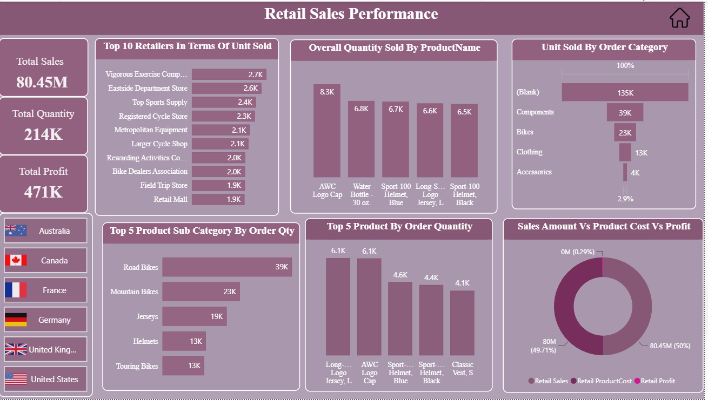
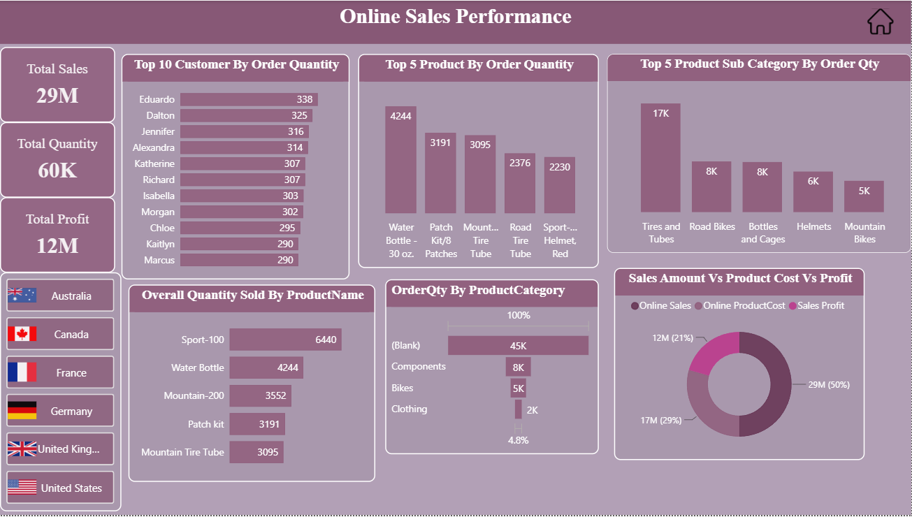
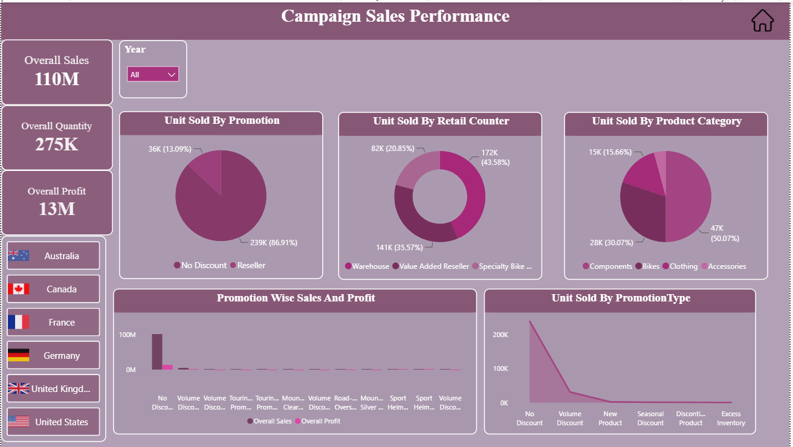

## essies_product_launch_dashboard

An end-to-end Power BI project covering data preparation, transformation, data modeling, and interactive sales dashboards.

# 1. Project Overview

This project explores sales performance across retail sales, online sales, and campaign sales. It uses Power BI to transform source data into interactive visual reports that help users explore sales, quantities, profits, products, customers, and promotional performance.

# 2. Problem Statement

Sales data across different channels and campaigns can be difficult to analyze without organized reporting. This project brings key sales information together in interactive dashboards to make comparisons and business trends easier to understand.

# 3. Dataset

Source: CSV files used for the project.
Data preparation: Data was loaded, cleaned, and transformed before visualization.

# 4. Tools and Technologies

Microsoft Power BI Desktop
Power Query
Data Cleaning and Transformation
Data Modeling and Relationships
DAX Measures
Data Visualization

# 5. Methodology

Data Loading: Imported the project data from CSV files into Power BI.
Data Cleaning: Prepared the data and handled data quality issues as required.
Data Transformation: Used Power Query to transform the data for analysis.
Data Modeling: Organized tables and relationships to support reporting.
Measure Preparation: Used relevant measures for sales, quantity, and profit analysis.
Dashboard Development: Designed charts, summary cards, category comparisons, and filters.
Report Organization: Arranged visual elements across three dashboard pages to present the analysis clearly.

# 6. Dashboard Pages

# A. Retail Sales Performance

This dashboard presents:
Total sales, quantity sold, and profit
Top retailers by units sold
Product-wise quantity comparisons
Product category and subcategory analysis
Sales amount, product cost, and profit comparison

# B. Online Sales Performance

This dashboard presents:
Total online sales, quantity, and profit
Top customers by order quantity
Top products by order quantity
Product subcategory comparisons
Sales, product cost, and profit visualization

# C. Campaign Sales Performance

This dashboard presents:
Overall campaign sales, quantity, and profit
Year-based filtering
Unit sales by promotion
Sales by retail counter and product category
Promotion-wise sales and profit comparisons

# 7. Key Observations

1. The retail dashboard helps analyze retailer performance, product demand, and category-wise sales trends.
2. The online sales dashboard provides insights into sales, profit, and product performance.
3. The campaign dashboard enables comparisons of promotional sales across products and retail counters.
4. The dashboards help stakeholders identify business trends, evaluate performance, and make data-driven decisions.

# 8. Results and Conclusion

The project transforms raw sales data into three interactive Power BI dashboards covering retail sales, online sales, and campaign performance. These dashboards provide a clear view of business trends and support data-driven analysis for sales planning, product performance evaluation, and campaign assessment.

# 9. Future Improvements

Add a sanitized sample dataset if sharing is permitted.
Document selected data preparation and transformation steps.
Improve the dashboard documentation with additional non-confidential analysis.

# Author

Shilpi Pandit
